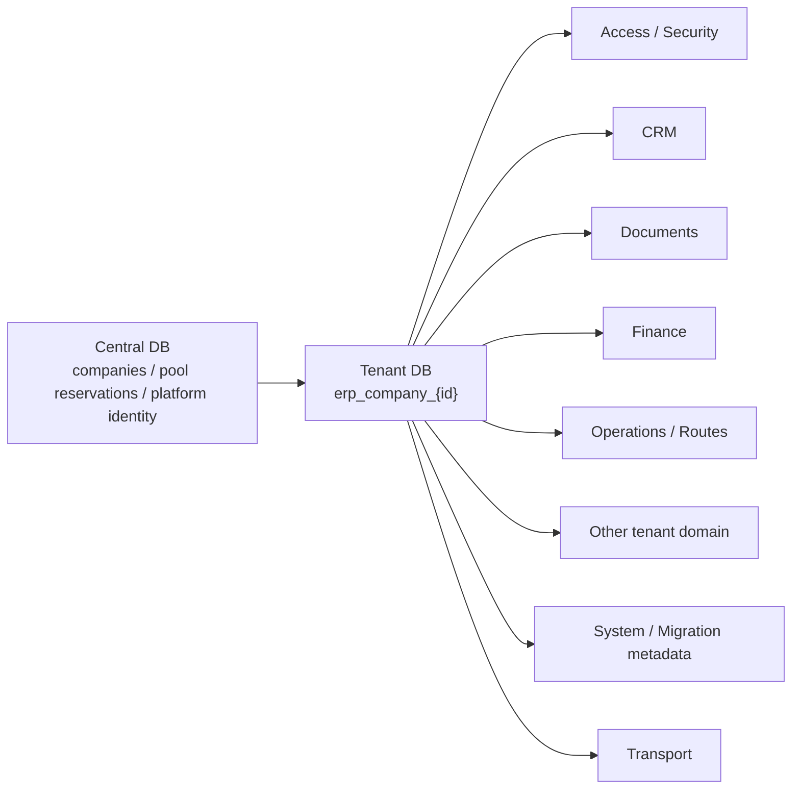
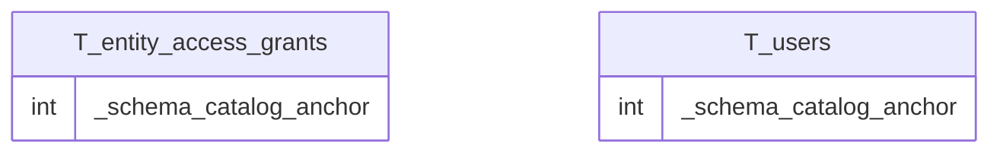
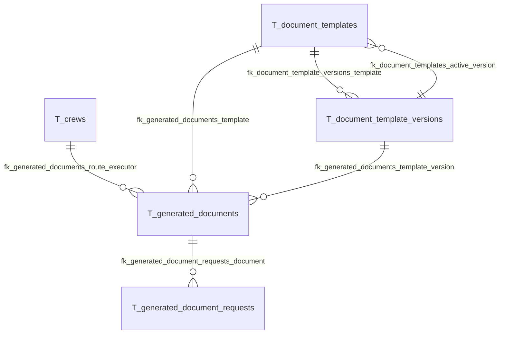
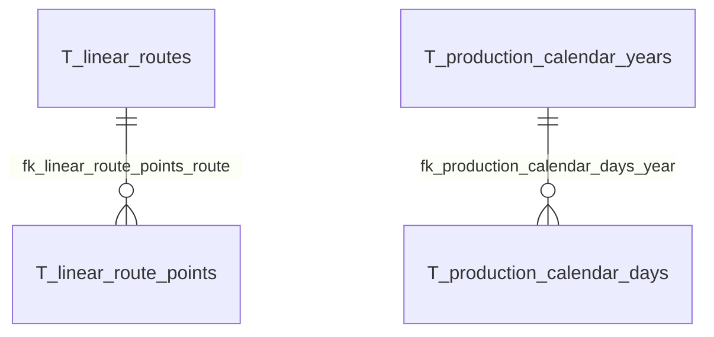
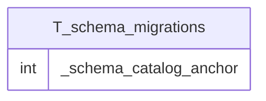

# ERP PLANEX — Tenant ERD

> GENERATED from final disposable-MySQL `information_schema`. Only physical FK edges are drawn.

**Schema fingerprint:** `a839e09922efd5a37e40b38d2298d46e3f87110e962be10e151acec54a552477`

## Architecture overview

The Central DB box is conceptual navigation only; this generator introspects the Tenant DB. Physical tenant columns live in `TENANT_SCHEMA.md`.

## Access / Security

Tables: `entity_access_grants`, `users`

## CRM

```mermaid
erDiagram
  T_client_contacts {
    int _schema_catalog_anchor
  }
  T_clients {
    int _schema_catalog_anchor
  }
  T_contractor_assignment_history {
    int _schema_catalog_anchor
  }
  T_contractor_contacts {
    int _schema_catalog_anchor
  }
  T_contractor_tax_history {
    int _schema_catalog_anchor
  }
  T_contractors {
    int _schema_catalog_anchor
  }
  T_responsible_assignment_history {
    int _schema_catalog_anchor
  }
```

Tables: `client_contacts`, `clients`, `contractor_assignment_history`, `contractor_contacts`, `contractor_tax_history`, `contractors`, `responsible_assignment_history`

## Documents

Tables: `document_template_versions`, `document_templates`, `document_types`, `documents`, `generated_document_requests`, `generated_documents`

## Finance

```mermaid
erDiagram
  T_finance_employee_movements ||--o{ T_finance_cash_resolutions : "fk_fcr_employee_movement"
  T_finance_operations ||--o{ T_finance_cash_resolutions : "fk_fcr_outflow_operation"
  T_finance_operations ||--o{ T_finance_cash_resolutions : "fk_fcr_source_operation"
  T_finance_operation_allocations ||--o{ T_finance_cash_route_receipts : "fk_fcrr_allocation"
  T_finance_operations ||--o{ T_finance_cash_route_receipts : "fk_fcrr_operation"
  T_bank_transactions ||--o{ T_finance_closing_counterparties : "fk_fcc_bank_transaction"
  T_bank_transactions ||--o{ T_finance_closing_document_links : "fk_fcdl_bank_transaction"
  T_documents ||--o{ T_finance_closing_document_links : "fk_fcdl_document"
  T_bank_transactions ||--o{ T_finance_closing_document_manual_statuses : "fk_fcdms_bank_transaction"
  T_finance_employee_movements ||--o{ T_finance_employee_invoice_payments : "fk_feip_employee_movement"
  T_finance_operations ||--o{ T_finance_employee_invoice_payments : "fk_feip_expense_operation"
  T_finance_invoices ||--o{ T_finance_employee_invoice_payments : "fk_feip_invoice"
  T_finance_operations ||--o{ T_finance_employee_invoice_payments : "fk_feip_receipt_operation"
  T_bank_transactions ||--o{ T_finance_employee_movements : "fk_fem_bank_tx"
  T_users ||--o{ T_finance_employee_movements : "fk_fem_employee"
  T_finance_operations ||--o{ T_finance_employee_movements : "fk_fem_operation"
  T_finance_invoices ||--o{ T_finance_invoice_links : "fk_fil_invoice"
  T_finance_invoices ||--o{ T_finance_operation_allocations : "fk_foa_invoice"
  T_finance_operations ||--o{ T_finance_operation_allocations : "fk_foa_operation"
  T_linear_route_payments ||--o{ T_finance_operation_allocations : "fk_foa_route_payment"
```

Tables: `bank_accounts`, `bank_daily_balances`, `bank_import_balances`, `bank_import_transactions`, `bank_statement_imports`, `bank_statement_settings`, `bank_transactions`, `finance_audit_log`, `finance_cash_flow_center_dds_categories`, `finance_cash_flow_centers`, `finance_cash_resolutions`, `finance_cash_route_receipts`, `finance_closing_counterparties`, `finance_closing_document_exceptions`, `finance_closing_document_links`, `finance_closing_document_manual_statuses`, `finance_closing_document_requirement_exceptions`, `finance_dds_categories`, `finance_employee_invoice_payments`, `finance_employee_money_accounts`, `finance_employee_movements`, `finance_employee_personal_expenses`, `finance_invoice_links`, `finance_invoices`, `finance_matching_results`, `finance_matching_rules`, `finance_money_accounts`, `finance_obligations`, `finance_operation_allocations`, `finance_operations`

## Operations / Routes

Tables: `cargo_types`, `linear_route_financial_terms`, `linear_route_payments`, `linear_route_points`, `linear_route_principals`, `linear_route_service_payments`, `linear_route_services`, `linear_routes`, `production_calendar_days`, `production_calendar_years`

## Other tenant domain

```mermaid
erDiagram
  T_feo_imports ||--o{ T_feo_import_changes : "fk_feo_import_changes_import"
  T_feo_placement_blocks ||--o{ T_feo_placement_block_requests : "fk_feo_placement_block_requests_block"
  T_feo_placement_blocks ||--o{ T_feo_placement_current : "fk_feo_placement_current_source_block"
  T_feo_request_cost_blocks ||--o{ T_feo_request_cost_block_requests : "fk_feo_request_cost_block_requests_block"
  T_feo_requests ||--o{ T_feo_request_utilizer_overrides : "fk_feo_request_utilizer_override_request"
  T_feo_utilizers ||--o{ T_feo_request_utilizer_overrides : "fk_feo_request_utilizer_override_utilizer"
  T_feo_imports ||--o{ T_feo_requests : "fk_feo_requests_current_import"
  T_feo_utilizers ||--o{ T_feo_utilizer_aliases : "fk_feo_utilizer_alias_utilizer"
  T_feo_utilizers ||--o{ T_feo_utilizer_match_rules : "fk_feo_utilizer_rule_utilizer"
  T_waste_trips ||--o{ T_waste_trip_audit_log : "fk_waste_trip_audit_trip"
  T_waste_trips ||--o{ T_waste_trip_legacy_import_audits : "fk_waste_trip_legacy_audit_trip"
  T_feo_requests ||--o{ T_waste_trip_requests : "fk_waste_trip_requests_feo"
  T_waste_trips ||--o{ T_waste_trip_requests : "fk_waste_trip_requests_trip"
  T_clients ||--o{ T_waste_trips : "fk_waste_trips_client"
  T_crews ||--o{ T_waste_trips : "fk_waste_trips_executor"
  T_users ||--o{ T_waste_trips : "fk_waste_trips_responsible"
  T_feo_utilizers ||--o{ T_waste_trips : "fk_waste_trips_utilizer"
```

Tables: `feo_import_changes`, `feo_imports`, `feo_placement_block_requests`, `feo_placement_blocks`, `feo_placement_current`, `feo_request_cost_block_requests`, `feo_request_cost_blocks`, `feo_request_utilizer_overrides`, `feo_requests`, `feo_utilizer_aliases`, `feo_utilizer_match_rules`, `feo_utilizers`, `waste_trip_audit_log`, `waste_trip_legacy_import_audits`, `waste_trip_requests`, `waste_trips`

## System / Migration metadata

Tables: `schema_migrations`

## Transport

Tables: `crew_drivers`, `crews`, `driver_phones`, `driver_vehicle_blocks`, `drivers`, `vehicle_sets`, `vehicle_units`
